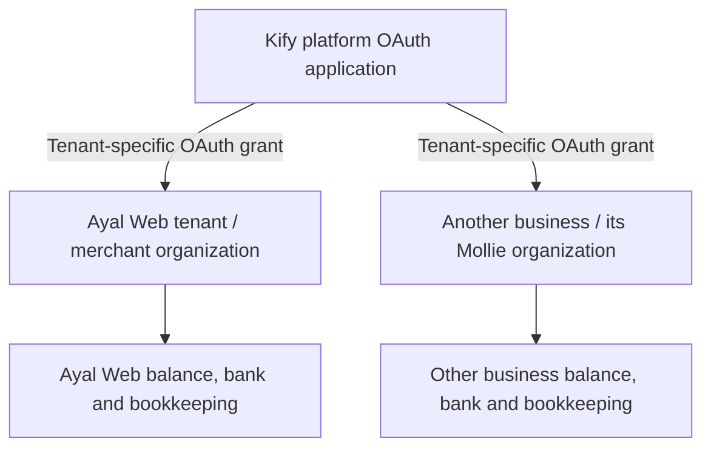

# Mollie Account Ownership

Status: accepted ownership model, clarified with the user on 7 November 2026
Audience: product, engineering and platform operators

## Platform And Merchant Roles

Kify uses **Mollie Connect for Platforms**. One platform OAuth application is
authorized separately by each merchant business. The platform organization owns
the application; it is not a shared collection account for those merchants.

| Concept | Meaning |
| --- | --- |
| Kify tenant | A business workspace. Several users can belong to it. |
| Platform Mollie organization | The business operating Kify, which owns the OAuth application. |
| Kify OAuth application | Registered once; identifies Kify when merchants grant permission. |
| Merchant Mollie organization | The business that owns its customers' payments, balance, fees and payouts. |
| Merchant profile | A storefront/payment configuration within that organization. A profile is not a separate legal business. |
| Paying customer | A buyer of the merchant's services; not automatically another Kify tenant. |

Each pilot tenant selects one Mollie organization and one profile. This is a
business-to-organization mapping, not one connection per human user. Do not
copy Ayal Web's credentials into another tenant or collect another merchant's
sales into Ayal Web's balance. A shared login or operator membership does not
change payment ownership.

Mollie balances and fee invoices can cover an organization rather than just the
selected profile. Future bookkeeping must account for other profiles sharing
that organization and must not import the same organization-wide fees twice.

## Accepted Ayal Web Setup

Keep the existing organization while Kify and Ayal Web operate under the same
legal business. A second organization is not required solely to distinguish
platform and merchant roles. A future change of legal ownership requires its
own provider/accounting review.

Production identity was reviewed against the connected merchant. Exact organization,
profile and application identifiers are retained in private operator evidence.
The same organization currently serves two roles. The application identity and
the tenant's authorization remain distinct. Existing OAuth credentials
successfully read the organization, selected profile and an existing live paid
payment; this is bounded read proof, not completion of every M6 acceptance test.

Charging merchants for use of Kify is a separate platform revenue flow. It is
not implemented by sharing their payment credentials or their customer
collections. Application fees/platform subscriptions need a separate product
and accounting decision.

## Credential Selection

| Credential | Owner and purpose |
| --- | --- |
| OAuth client ID / secret | Platform application; authorization-code exchange and token lifecycle. Not a merchant payment API key. |
| OAuth access / refresh tokens | One tenant's merchant authorization, encrypted and resolved with explicit tenant context. |
| Legacy live/test API key | That tenant and mode only; temporary compatibility when there is no OAuth connection row. |

`lib/mollie/tenant-connections.ts` selects OAuth whenever a connection row exists.
An unhealthy, disconnected or insufficiently scoped connection fails closed;
it never falls back to an API key. Only absence of a connection row permits
the same tenant/mode's legacy key.

Ayal Web currently has a connected OAuth row and a retained live API key. Its
normal runtime selects OAuth. The earlier bookkeeping inspection used the
retained key for bounded read-only calls; that did not identify runtime auth.
Do not delete the connection row to bypass OAuth failure. Inventory remaining
key consumers and finish the migration gate before retiring the old key.

See [the connection contract](mollie-connect-contract.md) for token handling,
scope enforcement, revocation and profile selection.

## New Merchant Onboarding

1. Provision the merchant's Kify tenant and user memberships.
2. Select that tenant, then connect the merchant's own Mollie organization by
   OAuth. Verify the organization identity and selected profile before billing.
3. Verify payment methods, payment and payout readiness, invoice settings,
   legal/contact defaults and that merchant's accounting connection separately.
4. Prove customer creation, payment, mandate, subscription, webhook and recovery
   behavior with the tenant-scoped credentials and correct money destination.
5. Complete cross-tenant access and reconnect/revocation checks before wider use.

Kify currently uses standard OAuth authorization; it does not implement the
Client Links API onboarding flow. New users do not need to paste an API key
for the normal Connect path.

Before broader onboarding, explicitly govern attempts to connect the same
Mollie organization to multiple independent Kify tenants. The inspected schema
enforces one connection per tenant, not a unique organization across tenants.
Do not describe duplicate-organization prevention as already implemented.

## J Housing Services Is A Separate External Relationship

J Housing Services (`org_19570291`, profile `pfl_o23bLYV8xN`) is distinct from
J Hailu Solutions. It remains in Mollie's Partners > Clients list. That page
lists connected merchant businesses, not Ayal Web's subscription customers.

The 8 October cleanup deleted JHS-owned Kify records, including its local
connection. It explicitly did not change Mollie. On 7 November, only Ayal Web
remained in Kify's tenant and connection tables and in the nonempty
tenant-scoped tables inspected. Historical notes and the encrypted recovery
backup remain intentionally; this is not a claim of erasing every historical
mention.

Local data deletion, token revocation, ending a Mollie partnership, and closing
a Mollie organization are separate operations. Review JHS's remaining external
authorization and the effects of ending its partnership before changing it.
Do not delete Kify's OAuth application to remove one merchant relationship.

Mollie's [merchant-management guide](https://docs.mollie.com/docs/connect-manage-merchants)
lists removal through Partners > Clients as a disconnection method, alongside
API token revocation and merchant-initiated revocation. Thus the visible
"End partnership" control is the relevant provider-side cleanup route. The
review has not exercised its confirmation flow or verified the resulting
authorization state; it is not an account-erasure operation.

## Bookkeeping Permissions

Current grants include payment/recurring and `sales-invoices.*` permissions.
They do not include `balances.read`, `settlements.read` or `invoices.read`.
The latter reads Mollie's own fee invoices; it is not `sales-invoices.read`.

These read permissions are candidates for the bookkeeping integration, not
already-granted production access. The optional consent upgrade is now
implemented separately in the preserved shared workspace; its original migration
0030, deployment, merchant reauthorization and
live endpoint proof remain. See the [connection contract](mollie-connect-contract.md).
Do not simply
add them to the globally required scope list and break existing payment-only
connections. Missing bookkeeping consent should have an explicit readiness
state. Payout/transfer write permissions are not needed for reconciliation.

The receipt branch excludes that optional bookkeeping-consent work. If resumed
after receipt migration 0031, regenerate it under a later number (0032 or above)
and a fresh journal timestamp; do not apply the old 0030 out of order. See the
[receipt migration contract](../operations/eboekhouden-receipt-automation.md).

## References

- [Mollie account and funds-flow concepts](https://docs.mollie.com/docs/core-concepts)
- [OAuth application and merchant authorization](https://docs.mollie.com/docs/authentication-via-oauth)
- [Payment ownership for Platforms](https://docs.mollie.com/docs/connect-process-payments)
- [7 November findings and remaining work](../operations/connect-and-bookkeeping-review-2026-11-07.md)
